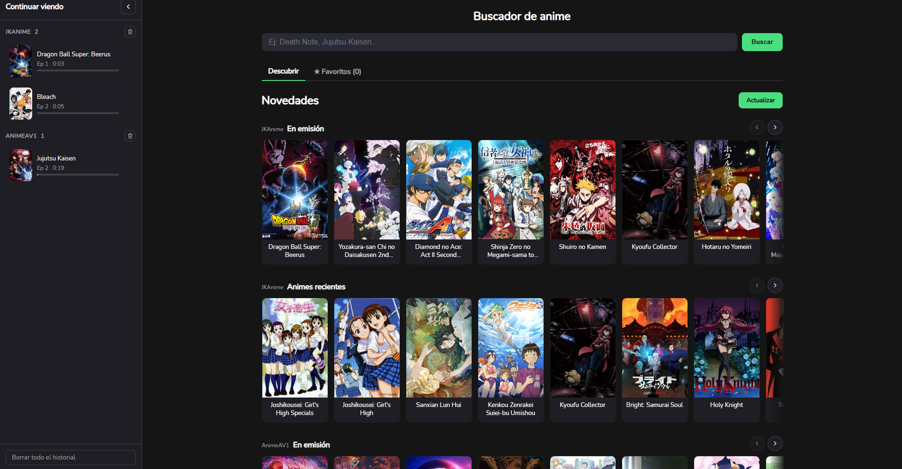
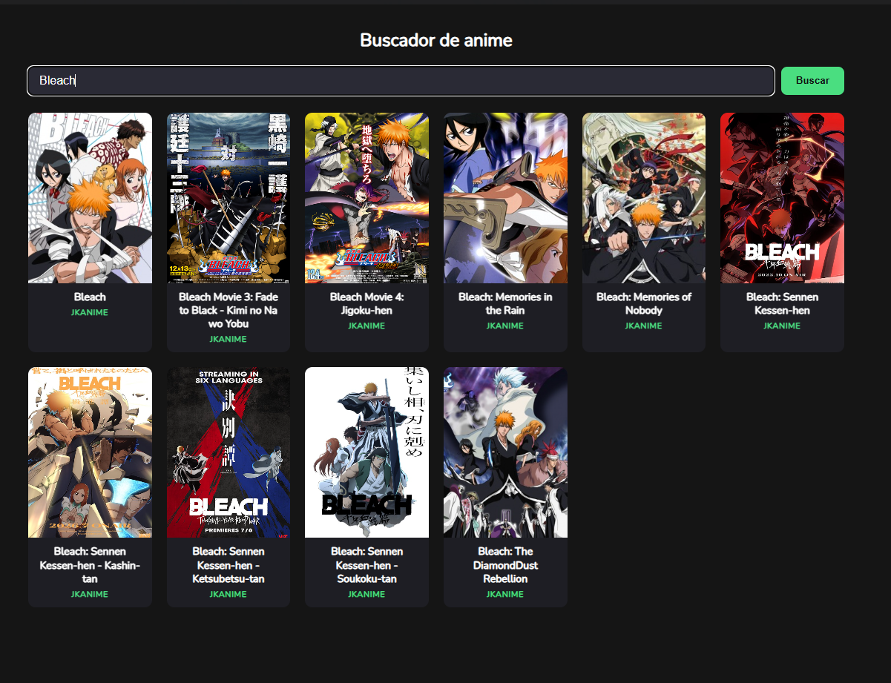
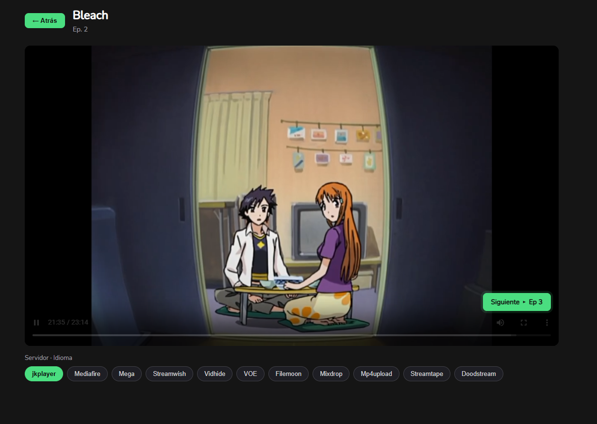

Readme · MD
# Comfort Anime Desktop
 
Aplicación de escritorio para Windows (la ventana se titula **CAD · Comfort Anime Desktop**) que te permite **buscar anime, ver la lista de episodios y reproducirlos** en una interfaz sencilla, con tu progreso guardado para retomar donde lo dejaste.
 

 
## Qué puedes hacer
 
- **Buscar** anime por nombre (busca a la vez en **JKAnime** y **AnimeAV1**, con los resultados de JKAnime primero).
- **Descubrir** novedades en la pantalla de inicio: filas por proveedor (**En emisión** y **recientes** de JKAnime y AnimeAV1), con botón **Actualizar**. Si un proveedor falla, el otro sigue visible y puedes pulsar **Reintentar**.
- **Ver el detalle y los episodios** de cada serie (la lista aparece poco a poco mientras carga y cada tarjeta se revela con una animación breve al entrar en pantalla; se respeta la preferencia de *reducir movimiento*).
- **Reproducir** el episodio directamente en la app, con selector de servidor/calidad e idioma (SUB/DUB) si el episodio tiene varias fuentes, y subtítulos cuando la fuente los incluye.
- **Retomar donde lo dejaste:** la app recuerda el minuto de cada episodio, marca los vistos y tiene un botón **Continuar**. Además, la **barra lateral del historial** agrupa tus animes por proveedor (lo más reciente primero) y **retoma con un clic**: continúa donde estabas o salta al siguiente episodio.
- **Borrar lo que quieras del historial:** deslizar la tarjeta hacia los lados o pulsar la ✕, con el aviso **Deshacer** durante 5 segundos; también puedes borrar el historial de un proveedor entero o todo el historial, con confirmación.
- **Marcar favoritos:** pulsa la estrella en la vista de detalle y encuéntralos en la pestaña **★ Favoritos** del inicio (se guardan en tu equipo y sobreviven a cerrar y abrir la app).
- **Saltar al siguiente episodio** con el botón **Siguiente ▸** del reproductor (o la tecla **N**): se ve atenuado mientras reproduces, se aclara al pasar el ratón o al pausar y se resalta cuando el episodio llega al 90 %. No aparece en películas ni en el último episodio.
- **Usarla en una ventana estrecha** (móvil o tableta): por debajo de 900 px la **hamburguesa se sustituye por una barra de navegación inferior** (Descubrir, Buscar, Favoritos, Historial) y el historial se abre como un **cajón** que no deja escapar el teclado. La cabecera del detalle es compacta y fija, la sinopsis se pliega tras 4 líneas con **Ver más**, los accesos al episodio quedan **pegados al pulgar** («Continuar · Ep. N» y «Reiniciar»), las tarjetas de episodio y los resultados se reparten en 2–3 columnas y los botones miden al menos 44 px. **En ventanas anchas (≥ 900 px) todo se ve igual que antes**: la barra lateral sigue a la izquierda y la geometría no cambia.
- **Ordenar los episodios** a tu gusto: el botón junto a «Episodios (N)» invierte la lista entre ascendente y descendente.
## Instalación
 
1. Ve a la sección [**Releases**](../../releases) de este repositorio y descarga el archivo `.zip` de la última versión.
2. Descomprímelo en la carpeta que quieras.
3. Ejecuta `miapp.exe`. No necesita instalador.
**Requisitos:** Windows 11 (usa el componente WebView2, que ya viene incluido). En Windows 10 puede que tengas que instalar [WebView2 Runtime](https://developer.microsoft.com/microsoft-edge/webview2/) por tu cuenta.
 
> **Aviso de Windows (SmartScreen):** como el ejecutable no está firmado digitalmente, Windows puede mostrar "Windows protegió su PC". Pulsa **Más información → Ejecutar de todas formas**. Si quieres verificar que el archivo es el original, compara su suma SHA256 con la que aparece en las notas de la release (`Get-FileHash archivo.zip` en PowerShell).
 
## Cómo se usa
 
1. Al abrir la app verás el inicio con novedades; haz clic en una o escribe un nombre en el buscador.
2. Haz clic en una serie para ver sus episodios y, si quieres, márcala con la estrella.
3. Haz clic en un episodio para reproducirlo; si un servidor no carga, elige otro.
4. El progreso se guarda solo cada pocos segundos; para retomar pulsa su tarjeta en la **barra lateral** (a la izquierda; se contrae y, en ventanas estrechas, se sustituye por la barra inferior, desde la que se abre el historial).
5. Para quitar algo del historial pulsa ✕ o desliza la tarjeta; tienes 5 segundos para **Deshacer**.
## Tus datos
 
La app solo guarda tu historial de visualización y tus favoritos, en tu propio equipo:
 
- `%AppData%\miapp\historial.json` — el progreso de cada episodio. Puedes copiarlo para hacer una copia de seguridad o borrarlo para empezar de cero.
- `%AppData%\miapp\favoritos.json` — los animes marcados con la estrella.
- `%AppData%\miapp.exe\` — carpeta del motor de la interfaz (WebView2). Se crea sola; puedes ignorarla.
No hay cuentas ni registro, y la app no envía tus datos a ningún servidor propio.
 
## Problemas frecuentes
 
| Problema | Qué hacer |
|---|---|
| **No aparecen resultados** | Prueba con otro nombre o espera un momento: los sitios de origen pueden estar caídos o haber cambiado. |
| **El episodio no carga** | Elige otro servidor en el selector. Si ninguno funciona, vuelve a intentarlo más tarde. |
| **Un servidor aparece como "iframe"** | Es un reproductor externo incrustado: funciona, pero **no guarda tu progreso**. |
| **"Continuar" no abre el último que vi** | Desde el detalle elige el episodio de mayor número con progreso, no el más reciente. Para retomar el último que viste usa la barra lateral del historial. Es una limitación conocida. |
| **El botón Siguiente ▸** se ve borroso | Es intencional mientras reproduces, para no distraer; pasa el ratón o pausa y se aclara. |
| **El inicio no muestra un proveedor** | Pulsa **Reintentar** o **Actualizar**; el sitio puede estar caído. |
| **Mi historial de una versión anterior** | Se conserva; sus registros aparecen al final de la barra hasta que los vuelvas a ver. |
 
## Limitaciones conocidas
 
- Solo para **Windows**.
- Hay dos fuentes de contenido: **JKAnime** y **AnimeAV1**, que se buscan a la vez (los resultados de JKAnime van primero). Si uno de los sitios cae, sigue funcionando el otro.
- Algunos servidores de vídeo son **iframes sin resolver**: se ven, pero no guardan tu progreso.
- Si un sitio cambia su estructura, la búsqueda o la reproducción pueden dejar de funcionar hasta que se actualice la app.
## Aviso legal
 
Este es un proyecto **personal y educativo**. La aplicación **no aloja, almacena ni distribuye ningún contenido audiovisual**: solo consulta sitios web de terceros y muestra lo que esos sitios ofrecen. Eres responsable de usarla conforme a las leyes de tu país y a los términos de los sitios que consultes. Los nombres y las marcas pertenecen a sus respectivos dueños, y este proyecto no está afiliado a ninguno de ellos.
 
## Para desarrolladores
 
Compilar desde el código, estructura del proyecto, tests y cómo publicar versiones: consulta [`docs/DESARROLLO.md`](docs/DESARROLLO.md).
